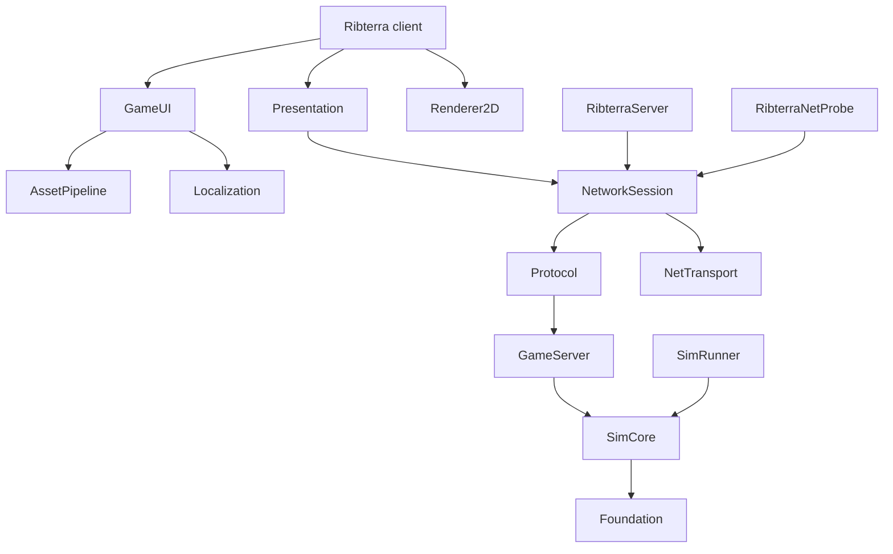

# Ribterra Engine

**Ribterra Engine** — експериментальний рушій на C++20 для кооперативної ізометричної стратегії про поселення. Він поєднує детерміновану симуляцію, авторитетний сервер, фізичну логістику, збереження світу, direct-IP мережу, локалізований інтерфейс і власний 2D/2.5D рендерний шлях поверх SDL3.

Репозиторій містить актуальний зріз вихідного коду рушія та пов'язаних із ним систем гри. Він має незалежну історію Git і включає зміни та нові вихідні файли з робочої папки оригінального проєкту. Це проєкт у розробці: компоненти мають чіткі межі й окремі перевірки; стабільний сторонній SDK і повна інтеграція нового рендерного шляху в усі сцени ще потребують роботи.

## Ідея

Ribterra будується навколо простої вимоги: одна й та сама симуляція повинна чесно працювати у локальній грі, на виділеному сервері, після збереження й завантаження та в мережевому сеансі.

Гравець керує не абстрактними числами, а поселенням із конкретними мешканцями, предметами й маршрутами. Ресурс існує як фізичний стек, працівник має дійти до нього, підняти вантаж і доставити його до складу або будівельного майданчика. Сервер приймає команди на межі тактів, перевіряє право керування й видимість, а клієнт отримує лише дозволену проєкцію стану.

Ця модель визначила головні технічні рішення:

- фіксований детермінований крок симуляції;
- один авторитетний `GameServer` для локальної та мережевої гри;
- типізовані команди й відповіді `Queued`, `Applied` та `Rejected`;
- обмежені черги, розміри повідомлень і бюджети роботи на такт;
- транзакційне складання мережевих знімків до зміни стану клієнта;
- версійовані FlatBuffers-схеми для мережі та збережень;
- відокремлення симуляції від SDL, GPU, UI і транспортної бібліотеки;
- єдиний впорядкований кадр `Frame2D` для світу, тексту та інтерфейсу.

## Для кого цей репозиторій

Вихідний код буде корисним:

- C++-розробникам, які вивчають поділ рушія на симуляцію, сервер, протокол, транспорт, presentation і renderer;
- авторам стратегій, colony sim та settlement sim, яким потрібні детермінований світ, фізична логістика й серверна авторитетність;
- розробникам мережевих ігор, які досліджують direct-IP сесії, reconnect, deduplication команд, full/delta snapshots і фільтрацію видимого стану;
- розробникам графіки, яким цікаві SDL_GPU, HLSL, ізометрична композиція, матеріали, тіні, атмосфера, вода й програмні діагностичні сцени;
- студентам і викладачам для розбору C++20, CMake, vcpkg, FlatBuffers, ECS, тестування та інструментів відтворюваності;
- майбутнім учасникам Ribterra, які хочуть зрозуміти чинні контракти перед зміною коду.

Публічний доступ до репозиторію сам по собі не надає права повторно використовувати або поширювати код та ігрові матеріали. Поточний стан ліцензування описано в розділі [Ліцензування](#ліцензування).

## Поточний стан

Рушій перебуває на етапі складання перевірених компонентів у єдиний production-шлях гри.

Реалізована основа охоплює:

- C++20-модулі `Foundation`, `SimCore`, `GameServer`, `Protocol`, `NetTransport` і `NetworkSession`;
- графічний клієнт, виділений сервер, мережеву пробу та headless simulation runner;
- двошаровий світ Surface/Mine, chunks, мешканців, будівлі, ресурси, логістику, професії, навички й ручні накази;
- версійовані збереження, атомарний запис файлів, міграційні й schema-conformance перевірки;
- full/delta snapshots, multipart assembly, reconnect і direct-IP сесію;
- SDL_GPU renderer, HLSL pipeline, текст, атласи, RmlUi та п'ять каталогів локалізації;
- окремі графічні компоненти для матеріалів, HDR-композиції, локального й небесного освітлення, контактних і sky-тіней, атмосфери та води;
- CTest-набори, headless benchmarks, software-rendered UI checks і спеціалізовані native probes.

Водночас цей репозиторій не заявляє, що:

- поточний зріз пройшов нову повну збірку й увесь CTest без помилок;
- усі критерії приймання рушія E01–E17 закриті;
- Dynamic/FullFX став стандартним шляхом кожної ігрової сцени;
- підтверджено цільову продуктивність повної сцени або заявлені бюджети GPU/VRAM;
- виконано актуальну перевірку кооперативу на двох фізичних ПК;
- код уже є незалежним від Ribterra універсальним рушієм.

Для цього публічного snapshot не виконували нову повну збірку. Походження, перелік файлів, SHA-256 і точні виключення зафіксовано в [`docs/SOURCE_SNAPSHOT_2026_10_12.json`](docs/SOURCE_SNAPSHOT_2026_10_12.json).

Детальний актуальний аудит міститься в [`docs/ENGINE_GAME_STATUS_2026_10_08_UA.md`](docs/ENGINE_GAME_STATUS_2026_10_08_UA.md), а вимоги й незакриті критерії — у [`docs/ENGINE_REQUIREMENTS.md`](docs/ENGINE_REQUIREMENTS.md).

## Технології

| Технологія | Де й навіщо використовується |
|---|---|
| **C++20** | Основна мова симуляції, сервера, мережі, presentation, renderer та інструментів. CMake забороняє compiler extensions і вмикає суворі попередження (`/W4 /permissive-` для MSVC, `-Wall -Wextra -Wpedantic` для GCC/Clang). |
| **CMake 3.25+ і Ninja** | Описує межі бібліотек та executable targets, генерує FlatBuffers-заголовки, компілює шейдери, реєструє CTest і встановлює runtime-пакет. |
| **vcpkg manifest mode** | Відтворювано підтягує залежності з baseline `04a9d8e5212d01ee1dd9478eadd9caade4f8b0d4`; renderer-пакети підключаються окремою feature `renderer`. |
| **Python 3** | Генерує таблицю балансу навичок, готує та перевіряє ассети, тестує контракти шейдерів і запускає частину evidence/network scenarios. |
| **SDL3 3.4.16 / SDL_GPU** | Створює Windows-вікно, обробляє ввід і керує GPU-ресурсами та проходами рендерера. Production-запуск Windows запитує Direct3D 12; software adapter використовується явно для автоматичних перевірок. |
| **SDL_ttf 3.2.2 і FreeType** | Растеризують текст і перевіряють покриття потрібних гліфів у staged fonts. |
| **RmlUi 6.3** | Відповідає за меню та HUD. `GameUI` перетворює геометрію RmlUi на впорядковані команди `Frame2D`, не отримуючи влади над симуляцією. |
| **ICU 78.3** | Форматує локалізовані повідомлення, named arguments і plural forms для English, української, русский, polski та español. |
| **HLSL, SDL_shadercross, DXC і SPIRV-Cross** | Build-time pipeline компілює шейдери, створює DXIL, reflection JSON і manifest. Компілятори шейдерів не входять до runtime-пакета. |
| **FlatBuffers 25.12.19** | Описує wire frames, network snapshots і payload збереження. Baseline schemas використовуються для перевірки сумісності. |
| **zstd 1.5.7** | Стискає збереження й мережеві payloads із перевіркою меж до виділення пам'яті та застосування стану. |
| **GameNetworkingSockets 1.6.0** | Реалізує direct-IP transport, connection lifetime і надійну доставку для окремих логічних потоків команд, чату та snapshots. |
| **OpenSSL 3.6.4** | SHA-256/криптографічні операції та HMAC-підтвердження пароля під час challenge/join без передавання пароля у власному пакеті Ribterra. |
| **EnTT 3.16.0** | Зберігає authoritative ECS-компоненти мешканців та пов'язаного стану в `SimCore`. Стабільні ID й відсортовані DTO підтримують детермінований порядок. |
| **nlohmann/json 3.12.0** | Читає конфігураційні, asset, diagnostic і localization-related JSON дані поза бінарними FlatBuffers-контрактами. |
| **libpng** | Завантажує й експортує PNG для texture/atlas pipeline та графічних проб. |
| **CTest** | Об'єднує unit, integration, schema, network, asset, UI, software-rendered і спеціалізовані contract tests. |

`Catch2` закріплений у `vcpkg.json`, але поточні test targets не використовують його як основний тестовий framework.

Повний перелік прямих і транзитивних компонентів, точних версій та notice-файлів наведено в [`THIRD_PARTY_NOTICES.md`](THIRD_PARTY_NOTICES.md).

## Архітектура

Основний напрямок залежностей:



### Модулі

| Модуль | Відповідальність |
|---|---|
| `Foundation` | Хеші, secure random, UTF-8 validation, atomic file replacement, базова економіка, lobby primitives і вузькі platform adapters. |
| `SimCore` | Детермінований fixed-step світ, ECS, chunks, path planning, фізичні предмети, логістика, будівництво, професії, навички, погода та серіалізація authoritative state. Не експонує типи SDL, GPU, RmlUi або GameNetworkingSockets. |
| `GameServer` | Єдиний writer ігрового стану: автентифікує гравця, впорядковує команди на межі тактів, перевіряє їх, дедуплікує request IDs і фільтрує snapshots. |
| `NetTransport` | Pimpl-адаптер над GameNetworkingSockets для listening, connections, bounded messages і транспортних lanes. |
| `Protocol` | FlatBuffers frames, compression bounds, full/delta snapshots, multipart split/assembly та перетворення лише видимого стану. |
| `NetworkSession` | Challenge/join, перевірка версій і content hash, acknowledgements, resync, reconnect, chat, autosave та цикл dedicated server. |
| `Presentation` | Читає `ClientSession`, перетворює ввід на типізовані команди та складає backend-neutral `Frame2D`. Не змінює `World` напряму. |
| `Renderer2D` | Володіє SDL_GPU resources, text rasterization, render passes і software test adapter. Отримує `Frame2D`, а не симуляцію або мережеву сесію. |
| `GameUI` | Володіє RmlUi context, формує UI-команди `Frame2D` та повертає application intents. |
| `AssetPipeline` | Дозволяє лише зареєстровані confined relative paths, перевіряє manifest і bytes, працює з texture atlases. |
| `Localization` | Завантажує п'ять locale catalogs і форматує ICU-повідомлення. |

### Шлях команди й кадру

```text
input
  -> Presentation створює типізовану команду
  -> NetworkSession / Protocol передає її
  -> GameServer перевіряє право, видимість і request ID
  -> SimCore застосовує команду на межі такту
  -> GameServer формує відфільтрований ViewSnapshot
  -> ClientSession атомарно приймає snapshot
  -> Presentation складає Frame2D
  -> Renderer2D і GameUI відображають кадр
```

Локальна гра проходить той самий шлях: executable `Ribterra` створює embedded `GameServer`, тому локальний клієнт не обходить серверну перевірку. `RibterraServer` запускає ту саму серверну частину без вікна й GPU.

## Зв'язок рушія з грою

Ribterra Engine уже має бібліотечні межі, але залишається інтегрованою технологічною основою конкретної гри:

- `SimCore` і серверні модулі найкраще відокремлені від клієнтських технологій, проте їхні доменні типи описують світ Ribterra;
- `Presentation` і `GameView` знають про snapshots, мешканців, будівлі, рельєф, fog, selection і правила ігрової композиції;
- `Renderer2D` приймає загальний `Frame2D`, але production materials, asset catalog і shader contracts розвивалися разом із візуальними потребами Ribterra;
- звичайна композиція гри та нові engine-control/material adapters ще зводяться в один завершений шлях;
- окремого стабільного SDK, package manager distribution, plugin API або гарантії сумісності для сторонніх ігор поки немає.

Репозиторій дає змогу вивчати цілісний рушій у контексті реальної гри. Перенесення окремого модуля в інший проєкт потребуватиме адаптації його доменних типів, ресурсів і контрактів.

## Структура репозиторію

```text
assets/             runtime art, UI, locale catalogs і asset manifest
cmake/              shader compilation та CMake helpers
content/            структуровані вихідні дані контенту
data/               data-driven balance, зокрема skills.json
docs/               архітектура, вимоги, контракти й історичні звіти
include/ribterra/    публічні заголовки внутрішніх модулів
licenses/            notices для fonts, SDL та Ribterra assets
schemas/             FlatBuffers network/save schemas і baselines
scripts/             bootstrap, build, package та release helpers
shaders/             HLSL programs і спільні include-файли
src/assets/          asset catalog і texture atlas
src/client/          client session, GameView і presentation adapter
src/foundation/      platform-neutral base services
src/net/             protocol, transport і network session
src/render/          SDL_GPU renderer, contact і sky shadows
src/server/          authoritative game server і dedicated entry point
src/sim/             world simulation, saves, skills і weather
src/ui/              RmlUi та localization integration
tests/               C++, Python, schema, rendering і evidence tests
tools/               runners, probes, exporters і diagnostic scripts
triplets/            project vcpkg triplets
vcpkg-overlays/      patched/pinned dependency ports
```

Ігровий README з описом механік та історією версій збережено окремо як [`docs/RIBTERRA_PROJECT_README.md`](docs/RIBTERRA_PROJECT_README.md). Історичні числа тестів і релізні докази в ньому стосуються конкретних старих зрізів, а не автоматично поточного коду цього репозиторію. Частина його посилань веде на локальні докази, концепти або screenshots, які свідомо не ввійшли до публічного snapshot.

## Збірка на Windows

### Потрібно

- Windows x64;
- Git;
- Python 3;
- Visual Studio 2022 або Visual Studio Build Tools;
- workload **Desktop development with C++**;
- MSVC x64 compiler, Windows SDK і компонент **C++ CMake tools for Windows**;
- доступ до інтернету під час першого bootstrap.

Клонування репозиторію:

```powershell
git clone https://github.com/fipsyatina/ribterra-engine.git
cd ribterra-engine
```

Основний шлях збірки з кореня репозиторію:

```powershell
powershell -ExecutionPolicy Bypass -File .\scripts\build.ps1
```

Скрипт послідовно:

1. завантажує офіційні SDL3 3.4.16 і SDL_ttf 3.2.2 archives та перевіряє їхні SHA-256;
2. клонує vcpkg у `.deps/vcpkg`, переходить на зафіксований baseline і вимикає telemetry під час bootstrap;
3. готує metadata для pinned shader toolchain;
4. знаходить MSVC і CMake через Visual Studio;
5. виконує `cmake --preset windows-release`;
6. збирає preset паралельно;
7. запускає `ctest --preset windows-release`;
8. лише після успіху встановлює runtime у `dist/releases/<version>/Ribterra` і оновлює `dist/current-build.txt`.

Після вже виконаного bootstrap можна пропустити повторне завантаження залежностей:

```powershell
powershell -ExecutionPolicy Bypass -File .\scripts\build.ps1 -SkipBootstrap
```

Ця команда все одно конфігурує, збирає, запускає CTest, встановлює версійну збірку й оновлює вказівник поточного build. Вона не є вузькою compile-only перевіркою.

### Окремий bootstrap

За потреби кроки можна виконати окремо:

```powershell
powershell -ExecutionPolicy Bypass -File .\scripts\bootstrap.ps1
powershell -ExecutionPolicy Bypass -File .\scripts\bootstrap-engine.ps1
```

Перший скрипт готує pinned SDL SDK. Другий готує pinned vcpkg і shader compiler port metadata. Інші manifest-залежності встановлюються vcpkg під час CMake configure.

### Headless-збірка

Headless preset вимикає `RIBTERRA_BUILD_CLIENT`, тому не створює SDL-вікно, RmlUi та клієнтський renderer. У shell, де доступні CMake, Ninja й налаштований C++ toolchain:

```powershell
powershell -ExecutionPolicy Bypass -File .\scripts\bootstrap-engine.ps1
cmake --preset headless
cmake --build --preset headless --parallel
ctest --preset headless
```

Preset `headless-ubsan` вмикає `RIBTERRA_ENABLE_UBSAN` і призначений для GCC або Clang із GNU command-line interface. CMake навмисно відхиляє цей режим для MSVC.

```powershell
cmake --preset headless-ubsan
cmake --build --preset headless-ubsan --parallel
ctest --preset headless-ubsan
```

## Перевірки та інструменти

Приклад GitHub Actions у [`docs/ci/build.yml`](docs/ci/build.yml) описує Windows build/test/package та Linux headless/UBSan jobs. У цьому репозиторії він збережений як документація; автоматичний CI потребує окремого налаштування workflow.

Після успішної Windows-збірки базові команди мають такий вигляд:

```powershell
powershell -ExecutionPolicy Bypass -File .\scripts\build.ps1 -SkipBootstrap
.\build\engine-windows\SimRunner.exe --ticks 1200 --population 10 --seed 70421
.\build\engine-windows\SimRunner.exe --benchmark
.\build\engine-windows\SimRunner.exe --benchmark-chunks
.\build\engine-windows\SimRunner.exe --benchmark-logistics
.\build\engine-windows\SimRunner.exe --benchmark-professions --ticks 10000
```

Репозиторій використовує кілька рівнів перевірки:

- звичайні C++ unit та integration executables через CTest;
- schema conformance для послідовних версій save і network frames;
- Python-перевірки balance data, assets, shader contracts і evidence records;
- process tests для окремого `RibterraServer` та `RibterraNetProbe`;
- network scenarios із контрольованими 1% і 3% packet loss;
- software-rendered UI/visual checks із dummy SDL video driver;
- native D3D12 probes, які записують renderer/device facts і PNG/JSON результати;
- `SimRunner` і `ManualOrderBench` для детермінованих headless та performance fixtures;
- `AtlasTool`, localization/font checks і staging validation для runtime assets.

`--renderer-info <file.json>` записує фактично вибрані backend, device, driver і software flag. Цей JSON підтверджує вибір backend у конкретному запуску, але сам по собі не доводить фізичне GPU, частоту кадрів або відповідність performance gate.

## Межі відтворення доказів

Публічний репозиторій містить вихідний код, а не всі локальні generated builds і збережені evidence-набори робочої машини. Зі snapshot виключено Git history оригінального проєкту, `build/`, `dist/`, `.deps/`, `vcpkg_installed/`, `artifacts/`, службові audit-каталоги, локальні saves і binaries, `docs/source/`, concepts, evidence, screenshots, непов'язані original art images та archives. Через це посилання в історичних аудитах на такі матеріали можуть не відкриватися у цьому репозиторії. Точний машинний перелік включень і виключень містить [`docs/SOURCE_SNAPSHOT_2026_10_12.json`](docs/SOURCE_SNAPSHOT_2026_10_12.json).

Частина спеціалізованих ізольованих probe-скриптів також перевіряє початковий абсолютний шлях `C:\Users\fipst\Desktop\ribterra` або читає локально збережені evidence inputs. Звичайні CMake presets і основний `scripts/build.ps1` визначають корінь від свого розташування, але такі вузькі probes потрібно спочатку параметризувати або запускати в очікуваному локальному середовищі.

Не використовуйте prune-скрипти як частину звичайної збірки. Вони створювалися для конкретних історичних allowlists і можуть змінювати або прибирати generated artifacts.

## Платформи й renderer backends

Перший production target — Windows x64. Звичайний Windows-клієнт явно запитує SDL_GPU backend `direct3d12`. SDL_GPU як бібліотека має інші backends, але їхня наявність не означає, що Ribterra вже пройшла на них повний build, renderer, input і visual acceptance.

Headless core і серверна архітектура відокремлені від renderer. Linux headless та UBSan використовувалися у попередніх checkpoints, однак актуальний результат потрібно отримувати заново для поточного commit. macOS/Metal, Apple Silicon packaging, Steam transport, Steam lobby та cross-platform session залишаються окремою майбутньою роботою.

## Документація

- [`docs/ARCHITECTURE.md`](docs/ARCHITECTURE.md) — повні контракти модулів, стану, мережі, збережень і bounded systems;
- [`docs/ENGINE_REQUIREMENTS.md`](docs/ENGINE_REQUIREMENTS.md) — реєстр вимог та критеріїв приймання;
- [`docs/ENGINE_GAME_STATUS_2026_10_08_UA.md`](docs/ENGINE_GAME_STATUS_2026_10_08_UA.md) — найдетальніший аудит інтеграції гри й рушія;
- [`docs/ASSETS.md`](docs/ASSETS.md) — manifest, staging, hashes, font coverage та atlas pipeline;
- [`docs/VALIDATION.md`](docs/VALIDATION.md) — версійні результати й межі історичних перевірок;
- [`docs/RIBTERRA_PROJECT_README.md`](docs/RIBTERRA_PROJECT_README.md) — оригінальний README гри, механіки та історія версій;
- [`docs/SOURCE_SNAPSHOT_2026_10_12.json`](docs/SOURCE_SNAPSHOT_2026_10_12.json) — provenance, file hashes, secret-scan scope та виключення публічного snapshot;
- [`THIRD_PARTY_NOTICES.md`](THIRD_PARTY_NOTICES.md) — зовнішні компоненти, версії та ліцензійні notices.

Оригінальна розробка гри ведеться в репозиторії [`fipsyatina/ribterra`](https://github.com/fipsyatina/ribterra). Його доступність визначається поточними налаштуваннями доступу того репозиторію; це посилання не є твердженням, що він публічний.

## Ліцензування

У корені цього snapshot немає окремого `LICENSE` для коду Ribterra. Чинний `THIRD_PARTY_NOTICES.md` зберігає всі права автора; нова ліцензія на повторне використання коду під час публікації не додавалася. Формулювання про private application code у цьому notice походить із попереднього режиму доступу. Для включення коду у власний продукт або поширення змінених версій потрібно узгодити дозвіл із правовласником.

Ігрові assets також мають власний notice у [`licenses/Ribterra-Assets.txt`](licenses/Ribterra-Assets.txt), який не надає дозволу на їх повторне поширення. Сторонні бібліотеки, шрифти й інші зовнішні матеріали зберігають свої окремі умови; відповідні notices лежать у [`licenses/`](licenses/) та описані в [`THIRD_PARTY_NOTICES.md`](THIRD_PARTY_NOTICES.md).

До вибору ліцензії цей репозиторій придатний для перегляду, технічного ознайомлення й обговорення внесків із автором. Для іншого використання коду або assets потрібно отримати окремий дозвіл правовласника.
