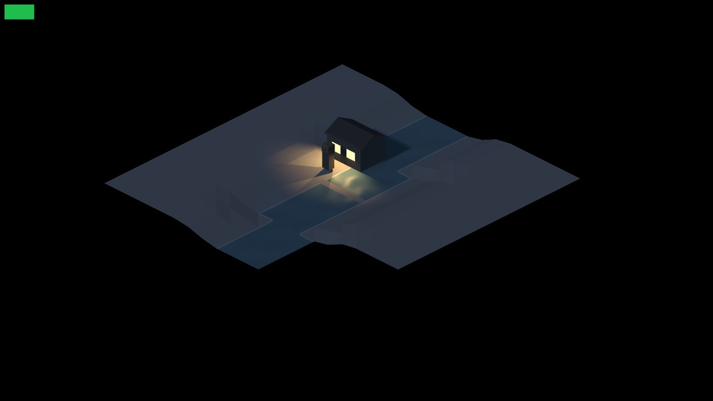
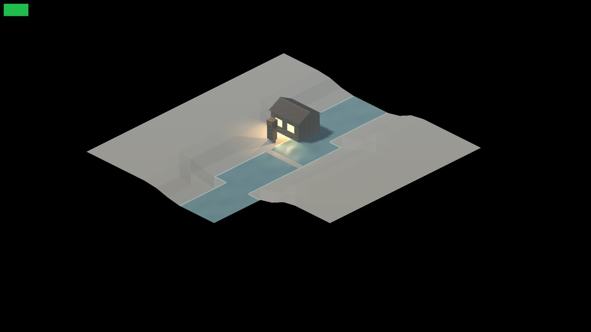
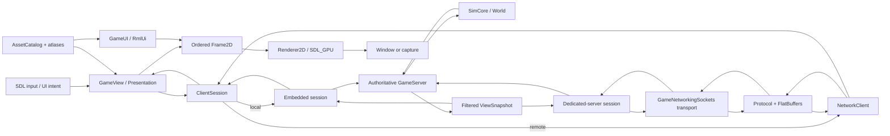

# Ribterra Engine

**Ribterra Engine** is an experimental C++20 engine for a cooperative isometric settlement strategy game. It combines deterministic simulation, an authoritative server, physical logistics, persistent worlds, direct-IP networking, localized UI, and a custom 2D/2.5D rendering path built on SDL3.

This repository is a public source snapshot of the engine and its connected game systems. It has an independent Git history and includes modified and newly created source files imported from the original working tree. The project remains under active development: its major components have defined boundaries and focused checks, while a stable third-party SDK and complete integration of the newest rendering path into every game scene remain future work.

## Development screenshots

| Darker scene lighting | Brighter scene lighting |
|---|---|
|  |  |
| A house, water channel, terrain, and warm local light under darker scene lighting. | The same development scene under brighter scene lighting, showing the water and terrain more clearly. |

These are user-supplied development screenshots of rendering work. They illustrate scene composition and lighting only; they are not a performance benchmark, proof of normal gameplay integration, or full production acceptance.

## Project idea

Ribterra starts from one design requirement: the same simulation should behave consistently in a local game, on a dedicated server, after save/load, and during a network session.

The player manages a settlement made of specific residents, items, buildings, and routes rather than abstract resource counters. A resource can exist as a physical stack. A worker must reach it, carry it, and deliver it to storage or a construction site. The server accepts commands at tick boundaries, checks ownership and visibility, and sends each client only the state that client is allowed to see.

That model drives the engine design:

- a deterministic fixed-step simulation;
- one authoritative `GameServer` for local and network play;
- typed commands with `Queued`, `Applied`, and `Rejected` replies;
- bounded queues, message sizes, and per-tick work budgets;
- transactional assembly of network snapshots before client state changes;
- versioned FlatBuffers schemas for network messages and saves;
- simulation code that does not depend on SDL, the GPU, RmlUi, or the transport library;
- one ordered `Frame2D` description for the world, text, and UI.

## Who this repository is for

The source is useful to:

- C++ developers studying how to separate simulation, server authority, protocol, transport, presentation, and rendering;
- strategy, colony-sim, and settlement-sim developers interested in deterministic worlds and physical logistics;
- networked-game developers exploring direct-IP sessions, reconnects, command deduplication, full/delta snapshots, and per-player state filtering;
- graphics developers interested in SDL_GPU, HLSL, isometric composition, materials, shadows, atmosphere, water, and diagnostic scenes;
- students and teachers studying C++20, CMake, vcpkg, FlatBuffers, ECS design, testing, and reproducible tooling;
- prospective Ribterra contributors who need to understand the current contracts before changing the code.

Public access does not by itself grant permission to reuse or redistribute the code or game assets. See [Licensing](#licensing).

## Current status

The engine is at the stage where individually checked components are being joined into one production game path.

The implemented foundation includes:

- C++20 library targets for `Foundation`, `SimCore`, `GameServer`, `Protocol`, `NetTransport`, and `NetworkSession`;
- a graphical client, dedicated server, network probe, and headless simulation runner;
- a two-layer Surface/Mine world with chunks, residents, buildings, resources, logistics, professions, skills, and manual orders;
- versioned saves, atomic file replacement, migration checks, and schema-conformance checks;
- full and delta snapshots, multipart assembly, reconnect, and direct-IP sessions;
- an SDL_GPU renderer, HLSL pipeline, text, atlases, RmlUi, and five localization catalogs;
- focused graphics components for materials, HDR composition, local and sky lighting, contact and sky shadows, atmosphere, and water;
- CTest suites, headless benchmarks, software-rendered UI checks, and specialized native probes.

This repository does **not** claim that:

- this snapshot has passed a new clean build and the complete CTest suite;
- every E01-E17 engine acceptance criterion is closed;
- Dynamic/FullFX is the default path for every game scene;
- full-scene performance or the stated GPU/VRAM budgets have been confirmed;
- cooperative play has been revalidated on two physical PCs for this snapshot;
- the code is already an independent, general-purpose engine for unrelated games.

No new full build was run for this public snapshot. Import provenance, the original file inventory, SHA-256 hashes, and exact exclusions are recorded in [`docs/SOURCE_SNAPSHOT_2026_10_12.json`](docs/SOURCE_SNAPSHOT_2026_10_12.json). That manifest records the original import. Later documentation translations and screenshot additions are follow-up repository changes, so the manifest is historical rather than a current-tree inventory and does not provide new build or test evidence.

The detailed integration audit is in [`docs/ENGINE_GAME_STATUS_2026_10_08_UA.md`](docs/ENGINE_GAME_STATUS_2026_10_08_UA.md). Requirements and open acceptance criteria are in [`docs/ENGINE_REQUIREMENTS.md`](docs/ENGINE_REQUIREMENTS.md).

## Technology

| Technology | How the project uses it |
|---|---|
| **C++20** | Implements the simulation, server, networking, presentation, renderer, and native tools. CMake disables compiler extensions and enables strict warnings (`/W4 /permissive-` on MSVC; `-Wall -Wextra -Wpedantic` on GCC/Clang). |
| **CMake 3.25+ and Ninja** | Define library and executable boundaries, generate FlatBuffers headers, compile shaders, register CTest tests, and install the runtime package. |
| **vcpkg manifest mode** | Resolves pinned dependencies from baseline `04a9d8e5212d01ee1dd9478eadd9caade4f8b0d4`; renderer dependencies are enabled through the separate `renderer` feature. |
| **Python 3** | Generates skill-balance data, stages and validates assets, checks shader contracts, and drives selected evidence and networking scenarios. |
| **SDL3 3.4.16 / SDL_GPU** | Creates the Windows client window, handles input, and manages GPU resources and render passes. The production Windows launch requests Direct3D 12; automated checks can explicitly request the software adapter. |
| **SDL_ttf 3.2.2 and FreeType** | Rasterize text and verify that staged fonts cover required glyphs. |
| **RmlUi 6.3** | Implements menus and the HUD. `GameUI` converts RmlUi geometry into ordered `Frame2D` commands without gaining authority over simulation state. |
| **ICU 78.3** | Formats localized messages, named arguments, and plural forms for English, Ukrainian, Russian, Polish, and Spanish catalogs. |
| **HLSL, SDL_shadercross, DXC, and SPIRV-Cross** | Compile shaders at build time and produce DXIL, reflection JSON, and a manifest. Shader compilers are not part of the runtime package. |
| **FlatBuffers 25.12.19** | Defines wire frames, network snapshots, and save payloads. Baseline schemas support compatibility checks. |
| **zstd 1.5.7** | Compresses saves and network payloads after size bounds are checked and before state is applied. |
| **GameNetworkingSockets 1.6.0** | Provides direct-IP transport, connection lifetime management, and reliable delivery for command, chat, and snapshot lanes. |
| **OpenSSL 3.6.4** | Provides SHA-256 and cryptographic operations, including the HMAC response used by the password challenge/join flow. |
| **EnTT 3.16.0** | Stores authoritative ECS components for residents and related state in `SimCore`. Stable IDs and sorted DTOs preserve deterministic ordering. |
| **nlohmann/json 3.12.0** | Reads configuration, asset, diagnostic, and localization-related JSON outside the binary FlatBuffers contracts. |
| **libpng** | Loads and exports PNG data for textures, atlases, and graphics probes. |
| **CTest** | Registers unit, integration, schema, network, asset, UI, software-rendered, and specialized contract tests. |

`Catch2` is pinned in `vcpkg.json`, but the current test targets do not use it as their main test framework. See [`THIRD_PARTY_NOTICES.md`](THIRD_PARTY_NOTICES.md) for direct and transitive components, exact versions, and notices.

## Architecture



The dedicated server uses the same authoritative `GameServer` and protocol/session logic without creating a window or renderer. `SimRunner` drives `SimCore` directly for deterministic headless scenarios and benchmarks.

### Module responsibilities

| Module | Responsibility |
|---|---|
| `Foundation` | Hashing, secure random data, UTF-8 validation, atomic file replacement, basic economy types, lobby primitives, and narrow platform adapters. |
| `SimCore` | Deterministic fixed-step world, ECS, chunks, path planning, physical items, logistics, construction, professions, skills, weather, and authoritative-state serialization. It exposes no SDL, GPU, RmlUi, or GameNetworkingSockets types. |
| `GameServer` | Sole writer of game state. It authenticates players, orders commands at tick boundaries, validates them, deduplicates request IDs, and filters snapshots. |
| `NetTransport` | Pimpl adapter over GameNetworkingSockets for listeners, connections, bounded messages, and transport lanes. |
| `Protocol` | FlatBuffers frames, compression limits, full/delta snapshots, multipart split/assembly, and conversion of visible state only. |
| `NetworkSession` | Challenge/join, version and content-hash checks, acknowledgements, resync, reconnect, chat, autosave, and the dedicated-server loop. |
| `Presentation` | Reads `ClientSession`, converts input into typed commands, and composes a backend-neutral `Frame2D`. It never writes to `World` directly. |
| `Renderer2D` | Owns SDL_GPU resources, text rasterization, render passes, and the software test adapter. It consumes `Frame2D`, not the simulation or network session. |
| `GameUI` | Owns the RmlUi context, emits UI draw commands into `Frame2D`, and returns application intents. |
| `AssetPipeline` | Resolves registered, confined relative paths; validates manifests and file bytes; and loads texture atlases. |
| `Localization` | Loads five locale catalogs and formats ICU messages. |

## How the engine works

### 1. Input becomes an authoritative command

`GameView` interprets SDL events and UI intents, then calls typed methods on `ClientSession`, such as move, gather, build, production, or settlement decisions. Presentation code never edits the world directly. The session attaches player and request context and sends the command through the local embedded path or the network protocol.

`GameServer::enqueue` authenticates the player-facing request and queues it. At a simulation tick boundary, the server checks command ownership, visibility, expected revisions, and command-specific rules. Request IDs allow repeated submissions to be recognized. The reply advances from `Queued` to either `Applied` or `Rejected`, while the world remains under one writer.

### 2. The simulation advances in bounded work

`SimCore` owns the authoritative `World`. Stable entity IDs and deterministic ordering keep equivalent runs comparable. The world advances resident work, physical item stacks, storage and reservations, logistics tasks, construction, path-search batches, professions, skills, weather, and other game systems through fixed steps. Expensive work is represented by queues and budgets so one request does not take unlimited work inside a tick.

The Surface and Mine are separate world layers connected by explicit portals. Chunks, visibility, and domain state remain simulation data; the renderer receives only a presentation projection.

### 3. Clients receive filtered snapshots

After ticks, the server builds a `ViewSnapshot` for each authenticated player. The snapshot includes that player's permitted view rather than exposing the complete authoritative world. `Protocol` converts it to a versioned FlatBuffers payload and can encode either a full snapshot or a delta from an acknowledged baseline.

Large snapshots are split into bounded parts. The client assembles all parts and validates revisions and limits before replacing its visible state. A missing baseline, timeout, or invalid part requests resynchronization instead of partially mutating the current view.

### 4. Presentation composes a backend-neutral frame

`GameView::compose` reads the current `ClientSession` view, camera state, selection, animation time, and loaded art. It emits an ordered `Frame2D` containing world primitives, textured geometry, text, material and lighting data, and UI geometry. `GameUI` adds RmlUi output to the same frame description.

This boundary keeps renderer ownership clear: presentation decides what should appear, while `Renderer2D` decides how to realize the frame on a backend.

### 5. SDL_GPU executes the frame

`Renderer2D` validates and prepares the frame, manages per-frame upload resources, records SDL_GPU command buffers, and presents to a swapchain or writes a requested capture. The source contains paths for material geometry, G-buffer data, reflection, contact and sky-shadow inputs, lighting, atmosphere/water composition, final composition, and UI.

Those capabilities exist at different integration and acceptance levels. The screenshots above demonstrate a development lighting scene; they do not establish that every pass is enabled in the normal game path or that the full renderer has met its performance target.

### 6. Save/load preserves authoritative state

The save path serializes authoritative world state through versioned FlatBuffers, applies size and schema checks, compresses the payload with zstd, records integrity metadata, and uses the atomic-file helper for replacement. Loading validates the container, checksum, schema requirements, bounds, and reconstructed state before importing it. Migration and baseline-schema checks cover supported historical formats.

### Local, dedicated, and headless execution

- **Local client:** `Ribterra` creates an embedded `GameServer`, so local play follows the same command validation path instead of writing directly to the world.
- **Dedicated server:** `RibterraServer` runs authoritative simulation, networking, snapshots, and autosave without GPU or UI ownership.
- **Network probe:** `RibterraNetProbe` exercises the external session path and protocol behavior.
- **Headless runner:** `SimRunner` drives deterministic simulation fixtures and benchmarks without the graphical client.

## Engine and game boundaries

Ribterra Engine has library boundaries, but it is still the integrated technology base of the Ribterra game:

- `SimCore` and server modules are the most independent from client technology, but their domain types describe the Ribterra world;
- `Presentation` and `GameView` understand snapshots, residents, buildings, terrain, fog, selection, and Ribterra composition rules;
- `Renderer2D` consumes the generic `Frame2D`, while production materials, the asset catalog, and shader contracts evolved alongside Ribterra's visual requirements;
- the standard game composition and newer engine-control/material adapters are still being joined into one complete path;
- there is no stable external SDK, package-manager distribution, plugin API, or compatibility promise for third-party games yet.

The repository is suitable for studying a complete engine in the context of a real game. Reusing a module elsewhere requires adapting its domain types, assets, and contracts.

## Repository layout

```text
assets/              runtime art, UI, locale catalogs, and asset manifest
cmake/               shader compilation and CMake helpers
content/             structured source content
data/                data-driven balance, including skills.json
docs/                architecture, requirements, contracts, and historical reports
include/ribterra/     public headers for internal modules
licenses/             notices for fonts, SDL, and Ribterra assets
schemas/              FlatBuffers network/save schemas and baselines
scripts/              bootstrap, build, package, and release helpers
shaders/              HLSL programs and shared include files
src/assets/           asset catalog and texture-atlas support
src/client/           client session, GameView, and presentation adapter
src/foundation/       platform-neutral base services
src/net/              protocol, transport, and network session
src/render/           SDL_GPU renderer, contact shadows, and sky shadows
src/server/           authoritative game server and dedicated entry point
src/sim/              world simulation, saves, skills, and weather
src/ui/               RmlUi and localization integration
tests/                C++, Python, schema, rendering, and evidence tests
tools/                runners, probes, exporters, and diagnostic scripts
triplets/             project vcpkg triplets
vcpkg-overlays/       patched or pinned dependency ports
```

The game-focused README, mechanics, and release history are preserved in [`docs/RIBTERRA_PROJECT_README.md`](docs/RIBTERRA_PROJECT_README.md). Historical test counts and release evidence in that document apply to their named older snapshots, not automatically to the current code. Some historical links point to local evidence, concepts, or screenshots that were intentionally excluded from the public source import.

## Building on Windows

### Requirements

- Windows x64;
- Git;
- Python 3;
- Visual Studio 2022 or Visual Studio Build Tools;
- the **Desktop development with C++** workload;
- the MSVC x64 compiler, Windows SDK, and **C++ CMake tools for Windows** component;
- internet access during the first dependency bootstrap.

```powershell
git clone https://github.com/fipsyatina/ribterra-engine.git
cd ribterra-engine
powershell -ExecutionPolicy Bypass -File .\scripts\build.ps1
```

The script resolves the repository root, bootstraps the pinned vcpkg tree, validates generated content and assets, configures the `windows-release` preset, builds, runs CTest, and installs the runtime only after successful checks. After a completed bootstrap, use `-SkipBootstrap` to avoid downloading dependencies again.

### Headless configuration

The headless preset disables `RIBTERRA_BUILD_CLIENT`; it does not create the SDL window, RmlUi integration, or client renderer. In a shell with CMake, Ninja, and a configured C++ toolchain:

```powershell
powershell -ExecutionPolicy Bypass -File .\scripts\bootstrap-engine.ps1
cmake --preset headless
cmake --build --preset headless
ctest --preset headless
```

The `headless-ubsan` preset enables `RIBTERRA_ENABLE_UBSAN` for GCC or Clang using a GNU-style command line. CMake intentionally rejects that mode under MSVC.

These entry points and preset names were checked against the repository scripts and `CMakePresets.json`. They were not rerun as a clean full build during this documentation update, so this README does not present them as fresh build evidence.

## Validation and tools

[`docs/ci/build.yml`](docs/ci/build.yml) is a GitHub Actions example for Windows build/test/package and Linux headless/UBSan jobs. It is retained as documentation; enabling automated CI requires a separately configured workflow.

After a successful Windows build, the checked-in `SimRunner` interface supports deterministic seeded runs and benchmark modes for the general simulation, chunks, logistics, and professions. The repository also contains process tests for `RibterraServer` and `RibterraNetProbe`, schema compatibility checks, shader reflection and asset checks, UI and renderer contracts, `ManualOrderBench`, `AtlasTool`, and staging/localization/font validation.

`--renderer-info <file.json>` records the selected backend, device, driver, and software flag for one run. That file confirms backend selection for that run; by itself it does not prove physical-GPU execution, frame rate, or compliance with a performance gate. Generated executables were not rebuilt for this documentation-only change.

## Evidence and reproducibility limits

The public repository contains source code, not every generated build or evidence bundle from the development machine. The original snapshot excluded the previous Git history, `build/`, `dist/`, `.deps/`, `vcpkg_installed/`, `artifacts/`, service audit directories, local saves and binaries, `docs/source/`, concepts, evidence, screenshots, unrelated original art images, and archives. The two development screenshots now shown in this README were added later as explicit follow-up files. Historical audit links to other excluded material may therefore be unavailable.

The exact original inclusion and exclusion inventory is in [`docs/SOURCE_SNAPSHOT_2026_10_12.json`](docs/SOURCE_SNAPSHOT_2026_10_12.json). Its hashes describe the import recorded at snapshot time; documentation translations and later image additions should be reviewed through subsequent Git commits.

Some specialized probe scripts check the original absolute path `C:\Users\fipst\Desktop\ribterra` or read locally retained evidence inputs. Standard CMake presets and `scripts/build.ps1` resolve the repository root from their own location, but those narrow probes must first be parameterized or run in their expected local environment.

## Platforms and renderer backends

The first production target is Windows x64. The regular Windows client explicitly requests the SDL_GPU `direct3d12` backend. SDL_GPU supports other backends as a library, but their availability does not mean Ribterra has passed complete build, renderer, input, and visual acceptance on those backends.

Headless simulation is structured separately and has Linux-oriented CMake presets. That supports simulation and server validation; it does not establish a supported Linux graphical client.

## Documentation

- [`docs/ARCHITECTURE.md`](docs/ARCHITECTURE.md) — module, state, networking, save, and bounded-system contracts;
- [`docs/ENGINE_REQUIREMENTS.md`](docs/ENGINE_REQUIREMENTS.md) — requirements and acceptance criteria;
- [`docs/ENGINE_GAME_STATUS_2026_10_08_UA.md`](docs/ENGINE_GAME_STATUS_2026_10_08_UA.md) — detailed game/engine integration audit;
- [`docs/ASSETS.md`](docs/ASSETS.md) — manifests, staging, hashes, font coverage, and the atlas pipeline;
- [`docs/VALIDATION.md`](docs/VALIDATION.md) — version-specific results and limits of historical validation;
- [`docs/RIBTERRA_PROJECT_README.md`](docs/RIBTERRA_PROJECT_README.md) — game mechanics and version history;
- [`docs/SOURCE_SNAPSHOT_2026_10_12.json`](docs/SOURCE_SNAPSHOT_2026_10_12.json) — original import provenance, hashes, secret-scan scope, and exclusions;
- [`docs/DOCUMENTATION_UPDATE_2026_10_12.json`](docs/DOCUMENTATION_UPDATE_2026_10_12.json) — English translation scope, verification, and supplied screenshot hashes;
- [`THIRD_PARTY_NOTICES.md`](THIRD_PARTY_NOTICES.md) — third-party components, versions, and license notices.

Some paths retain legacy `_UA` or `-uk` filename suffixes so existing references remain stable; their documentation content is now English. Runtime locale names and exact multilingual test or historical prompt literals remain unchanged where they are part of product behavior or evidence.

Original game development continues in [`fipsyatina/ribterra`](https://github.com/fipsyatina/ribterra). Its availability depends on that repository's current access settings; this link does not claim that it is public.

## Licensing

This snapshot has no separate root `LICENSE` for Ribterra code. The current [`THIRD_PARTY_NOTICES.md`](THIRD_PARTY_NOTICES.md) reserves the author's rights; publication did not add a new license granting reuse of the code. The notice's reference to private application code comes from the repository's earlier access model. Contact the copyright holder before incorporating the code into another product or distributing modified versions.

Game assets have a separate notice in [`licenses/Ribterra-Assets.txt`](licenses/Ribterra-Assets.txt), which does not grant redistribution rights. Third-party libraries, fonts, and other external material retain their own terms; their notices are stored under [`licenses/`](licenses/) and summarized in [`THIRD_PARTY_NOTICES.md`](THIRD_PARTY_NOTICES.md).

Until a license is selected, this repository is available for source review, technical study, and contribution discussions with the author. Any other use of the code or assets requires separate permission from the rights holder.
